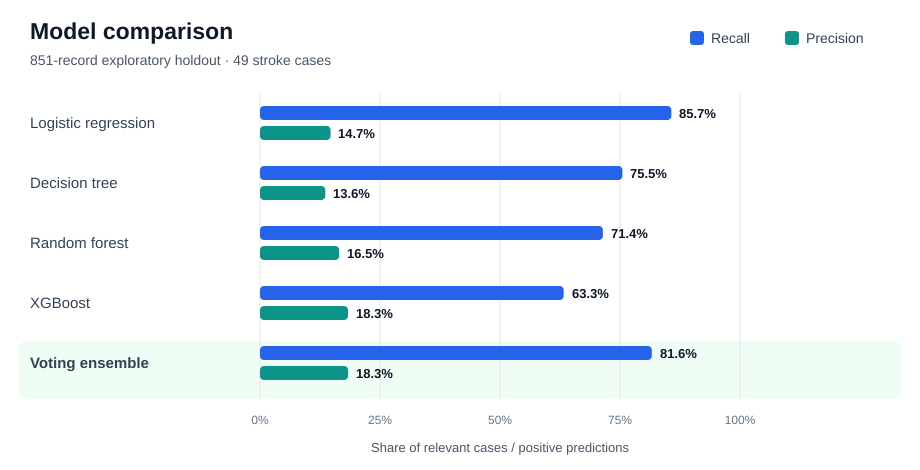
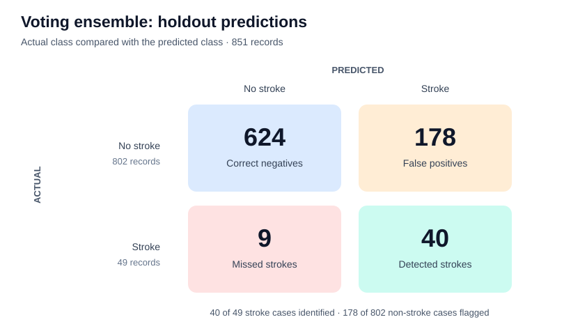

# Stroke Prediction

This project explores whether demographic and health information can distinguish records with a reported stroke from those without one. It brings together exploratory data analysis, a comparison of classification models, a reusable training pipeline, and a Streamlit app for single-record predictions.

**At a glance:** 5,110 source records · 5 models compared · 81.6% recall and 18.3% precision for the best-F1 model on an exploratory holdout set.

## Dataset

The project uses the [Stroke Prediction Dataset on Kaggle](https://www.kaggle.com/datasets/fedesoriano/stroke-prediction-dataset). The included `data/raw.csv` has **5,110 records**, **10 predictors**, an ID column, and a binary `stroke` target. Stroke is present in **249 records (4.9%)**, making class imbalance central to model evaluation. There are **201 missing BMI values**.

Inputs include age, gender, hypertension, heart disease, marital and work status, residence type, average glucose level, BMI, and smoking status. The exploratory notebook uses `data/cleaned.csv`, which contains **4,254 adult records**, including **247 stroke cases**, after its cleaning and age filter.

## Approach

1. Explore class balance and feature distributions in [`notebooks/EDA.ipynb`](notebooks/EDA.ipynb).
2. Prepare the exploratory dataset with BMI imputation, outlier capping, a glucose transformation, categorical encoding, and a derived `health_factor` feature.
3. Compare logistic regression, decision tree, random forest, XGBoost, and an XGBoost + logistic regression soft-voting ensemble in [`notebooks/model_testings.ipynb`](notebooks/model_testings.ipynb). A stratified 80/20 split preserves the minority class in the holdout set; five-fold cross-validation measures F1 on the training portion. The notebook also reports recall, precision, F1, ROC-AUC, and average precision on the holdout set.
4. Train the application model with [`src/train.py`](src/train.py). Its scikit-learn pipeline handles BMI imputation and feature engineering, scales numeric fields, one-hot encodes categorical fields, and fits the soft-voting ensemble. The fitted pipeline is saved to `models/stroke_pipeline.pkl`.
5. Enter a record in the [Streamlit app](app.py) to view its predicted class and probability.

Class weights and XGBoost's `scale_pos_weight` address imbalance in the selected ensemble. Although the notebook imports SMOTE as an optional experiment, the reported model comparison and saved application pipeline do **not** use it.

## Exploratory model results

These results come from the saved output in [`notebooks/model_testings.ipynb`](notebooks/model_testings.ipynb). The **851-record holdout set** contains **49 stroke cases** and **802 non-stroke cases**. Recall measures how many stroke cases were found; precision measures how many positive predictions were actually stroke cases. Both matter when the positive class is rare.



| Model | Recall | Precision | F1 | ROC-AUC | Average precision |
| --- | ---: | ---: | ---: | ---: | ---: |
| Logistic regression | 85.7% | 14.7% | 0.251 | 0.849 | 0.237 |
| Decision tree | 75.5% | 13.6% | 0.231 | 0.785 | 0.191 |
| Random forest | 71.4% | 16.5% | 0.268 | 0.841 | 0.207 |
| XGBoost | 63.3% | 18.3% | 0.284 | 0.835 | 0.211 |
| **XGBoost + logistic regression voting** | **81.6%** | **18.3%** | **0.300** | **0.847** | **0.257** |

The voting ensemble has the **highest holdout F1 (0.300)** and **highest average precision (0.257)** of the five models. Its mean F1 across the five training folds was **0.273 ± 0.012**. Logistic regression alone reached slightly higher recall (85.7%), but the ensemble reduced false positives from **243 to 178** while detecting **40 rather than 42** of the 49 stroke cases.

### Where the ensemble succeeded and failed



The ensemble found **40 of 49 stroke cases** and missed **9**. It also flagged **178 of 802 non-stroke cases**, so only **40 of its 218 positive predictions** were correct. This explains why a seemingly strong recall coexists with **18.3% precision**. The figures describe performance at the model's default classification threshold on this particular holdout set.

### How to interpret these numbers

The notebook evaluates a cleaned adult subset, while `src/train.py` trains the saved app pipeline on the raw dataset with a different preprocessing path. **These charts and metrics do not validate the saved application model.** The notebook's cleaning was performed before its train/test split, which may make the exploratory scores optimistic. Model selection also used this same holdout set; an untouched final test set and external validation would be needed for a stronger performance claim.

## Run locally

From the project root:

```bash
python -m venv .venv
source .venv/bin/activate
python -m pip install -r requirements.txt
streamlit run app.py
```

The repository includes the saved model at `models/stroke_pipeline.pkl`. To retrain it from `data/raw.csv`, run:

```bash
python src/train.py
```

The app accepts one patient record at a time and displays the model's stroke-class probability. For exploratory analysis, open the notebooks from the `notebooks/` directory.

## Project structure

```text
app.py                      Streamlit prediction interface
data/raw.csv                Source data used by the training script
data/cleaned.csv            Prepared adult subset used in notebook experiments
models/stroke_pipeline.pkl  Saved application pipeline
notebooks/                  Exploratory analysis and model comparison
src/preprocessing.py        Feature engineering transformer
src/pipeline.py             Application model pipeline definition
src/train.py                Training and model export
src/predict.py              Single-record command-line example
```

## Scope

This is an educational machine learning project, not a clinical screening tool. The dataset is highly imbalanced, the exploratory test set contains only 49 stroke cases, and the saved app model has no separately documented holdout or external validation. Its displayed probability has not been calibrated or clinically validated and should not be used to make medical decisions.
